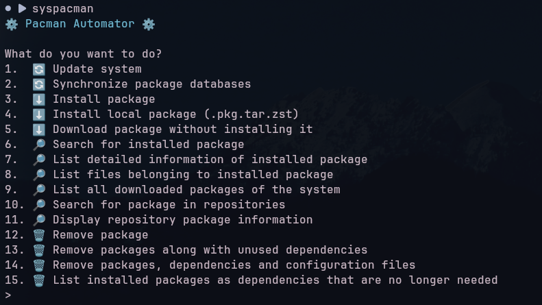

# <p align="center">Pacman Automator</p>

<p align="center">
  An interactive command-line tool for automating Pacman package management operations on Arch Linux.
</p>

<p align="center">
  
  
  
  
</p>

---

## Overview

**Pacman Automator** is a Python-based tool designed to simplify package management on Arch Linux.

It provides an interactive terminal interface that allows users to execute various Pacman operations through a single menu, eliminating the need to manually type commands for everyday package management tasks.

<p align="center">
    
</p>

## Features

### System Management
- Update the entire system.
- Synchronize package databases.

### Package Installation
- Install packages from native repositories.
- Install local packages (`.pkg.tar.zst`).
- Download packages without installing them.

### Package Information
- Search for installed packages.
- Display detailed information about installed packages.
- List files belonging to installed packages.
- List all installed packages.
- Search for packages in repositories.
- Display repository package information.

### Package Removal
- Remove packages.
- Remove packages along with unused dependencies.
- Remove packages, dependencies and configuration files.

### System Maintenance
- List orphaned dependencies.

## Notes before installing and using

- After installing, a folder named **pacmanAutomator** will be created in `~/.config` with the automator scripts.
- The **syspacman** will be located in `/usr/local/bin`
- The operations that require a package, like `sudo pacman -S package` only support **1** package. Example: `sudo pacman -S fastfetch`

## Requirements

- Python 3
- Noto Fonts Emoji
- Pacman Package Manager
- Arch Linux or an Arch-based distribution (CachyOS, EndeavourOS, ...)

## Installation

Install dependencies:

```bash
sudo pacman -S python noto-fonts-emoji
```

Clone the repository:

```bash
git clone https://github.com/mxrtins2024/pacmanAutomator
```

Navigate to the project directory:

```bash
cd pacmanAutomator
```

Scripts installation:

```bash
python install.py
```

To start using, enter:

```bash
syspacman
```

## Usage

After starting the program, an interactive menu will be displayed with the available operations.

Select the desired operation by entering its corresponding number and follow the instructions displayed in the terminal.

Some operations require administrator privileges and may prompt for your password through `sudo`.

## Disclaimer

This project is an independent tool that uses the native Pacman package manager.

**It does not replace Pacman or modify its internal functionality**. All package management operations are executed through native Pacman commands.

**Always review package operations before confirming them**, especially when removing packages or updating the system.
